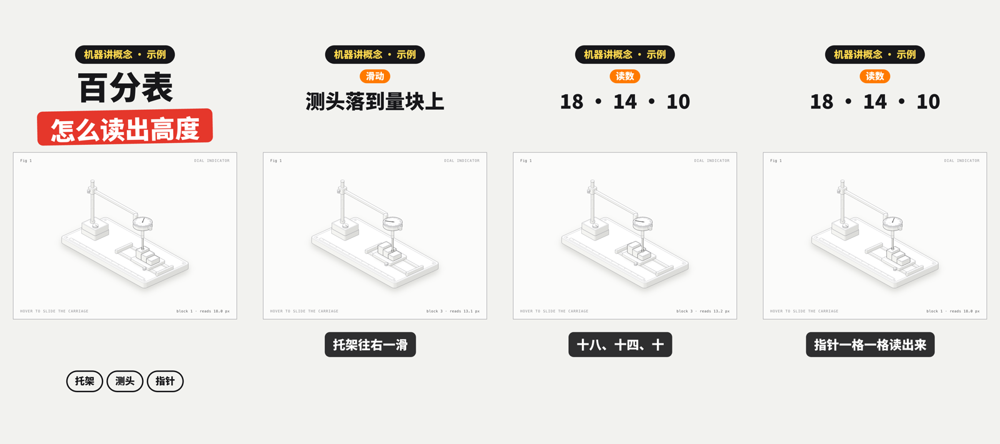
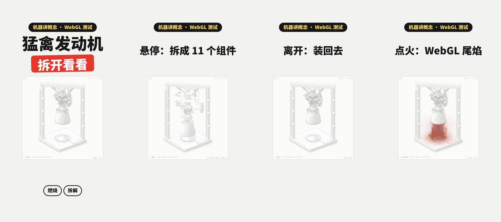

# anatomy-video

[English](README_EN.md) | 中文

[](LICENSE)
[](https://www.python.org/)
[](https://nodejs.org/)
[](skills/anatomy-video/bridge)
[](skills/anatomy-video/SKILL.md)

> 用代码做视频，用机器讲概念。

一个 agent skill，合并了两个开源项目，再加一层桥接把它们连起来：

- **[xilo-opus-video](https://github.com/Kianzzz/xilo-opus-video)**：让模型写一个按时间 t 画画面的网页，逐帧截图合成视频。先给三个方案和预览，确认后再做。这里用的是 [加了配音流水线的 fork](https://github.com/anneheartrecord/xilo-opus-video)：文字稿转带配音、字幕、封面的竖版短视频，事实核查、并行渲染。
- **[Anatomy](https://github.com/wheresryan22/anatomy)**：把一个技术概念造成一台真实的机器，几十个小零件、四色明暗、等距视角，鼠标一碰就动，自带几何审计，可选 WebGL 着色器和 3D。
- **桥接（`bridge/`，本仓库新增）**：用一个虚拟时钟接管 Anatomy 页面的动画时间，把可交互的机器变成任意一帧都能单独算出来的视频画面；旁白念到哪个词，就在那一刻给机器注入悬停、滑动、按键、点击，让它拆开、点火、换挡。

## 三类产出

| 你要的 | 走哪条路 |
|---|---|
| 一条视频：宣传片、动效、知识讲解、文字稿转视频 | 视频流程：需求 → 三个方案和预览 → brief → 逐镜头制作 → 自检 → 成片、封面图、发布文案 |
| 一张插图、交互图、原理图（给文档、博客、落地页） | Anatomy：HTML、单独的 SVG 或 React 组件 |
| 一条讲原理的视频，概念能对应到一台会动的机器 | 先用 Anatomy 造机器，再配音、按旁白驱动机器、包装成视频 |

## 效果

**百分表（Anatomy 最小的例子）配上旁白**：念到「往右一滑」托架滑过去，念到每个量块，测头就落到那一块上，读数跟着变。



**猛禽发动机（带 WebGL 尾焰）**：悬停拆成 11 个组件，离开装回去，点火时 WebGL 尾焰在同一个等距视角里喷出来。



两条都由同一个页面逐帧渲染：同一时刻渲两次逐像素相同，顺序渲染和并行渲染逐帧一致。

## 安装

```bash
npx skills add anneheartrecord/anatomy-video
```

或者手动复制：

```bash
git clone https://github.com/anneheartrecord/anatomy-video.git
cp -r anatomy-video/skills/anatomy-video ~/.claude/skills/
```

### 需要的环境

- Python 3.9+，以及 `numpy`、`scipy`、`playwright`（`python3 -m pip install numpy scipy playwright`），再 `python3 -m playwright install chromium`
- FFmpeg
- Node.js 20.10+（Anatomy 的构建和检查只用 Node 内置模块，不用 `npm install`）
- 配音二选一：环境变量 `GEMINI_API_KEY`（Gemini TTS），或者 `edge-tts`（免费，`uv tool install edge-tts`）
- 对齐用的 Whisper：Apple Silicon 用 `mlx-whisper`，其他机器用 `faster-whisper`；不想全局安装可以 `uv run --with mlx-whisper ...`

## 怎么用

直接说你想做什么：

```text
把这篇文章做成一条 60 秒的竖版视频，要配音和字幕（附上文字）
```

```text
画一张等距插图，解释 token bucket 限流器是怎么工作的，可交互，浅色主题
```

```text
做一条讲 CDN 缓存命中和未命中的竖版视频，用一台会动的机器讲清楚，旁白讲到哪一步，机器就做哪一步
```

## 桥接怎么工作

- **`bridge/clock.js`**：插在页面 `<head>` 最前面，接管 `requestAnimationFrame`、`performance.now`、`Date.now`、`setTimeout / setInterval`，让时间停在 0；`render(t)` 时以 1/60 秒的固定步长推进到 t。Anatomy 的指数跟随和弹簧依赖上一帧，这样它们也变成了时间的纯函数。`IntersectionObserver` 一律报告可见，减少动效一律关闭，机器不会因为「不在屏幕上」停住。
- **`bridge/overlay.js`**：把卡片缩放进竖版画面，在上面画系列胶囊、封面两行大字、各场景标题和字幕；按 `video.json` 的动作表，在旁白动作点那一刻派发指针和按键事件（`pointerenter / pointerleave` 沿祖先链派发，和浏览器一致）。
- **`bridge/wrap_figure.py`**：把一个构建好的 Anatomy 页面包装成视频页，原页面不改。

完整流程和 `video.json` 写法见 [`references/anatomy-video.md`](skills/anatomy-video/references/anatomy-video.md)，可复现的例子在 [`bridge/example/`](skills/anatomy-video/bridge/example)。

## 目录

```
skills/anatomy-video/
  SKILL.md                 分流（视频 / 插图 / 机器讲概念）+ 视频流程
  references/              视频流程的参考文档（方案、brief、制作规则、封面与开头、配音流水线、事实核查、机器讲概念）
  scripts/                 渲染（含并行）、配音流水线、事实核查、自检拼图、文件命名、音频工具
  templates/               竖版讲解模板
  bridge/                  虚拟时钟、视频叠加层、页面包装脚本、示例（本仓库新增）
  anatomy/                 Anatomy 原样收录：SKILL.md、kit/、scripts/、references/、examples/
examples/                  README 用的效果图
```

## 致谢与协议

- 视频流程、参考文档和渲染脚本来自 [周行（Kianzzz）](https://github.com/Kianzzz) 的 [xilo-opus-video](https://github.com/Kianzzz/xilo-opus-video)。
- `anatomy/` 原样收录自 [Ryan（@wheresryan22）](https://github.com/wheresryan22) 的 [Anatomy](https://github.com/wheresryan22/anatomy)，未做修改。
- 各部分的来源、版本和改动见 [NOTICE.md](NOTICE.md)。

MIT，保留所有原作者的版权声明，见 [LICENSE](LICENSE)。
